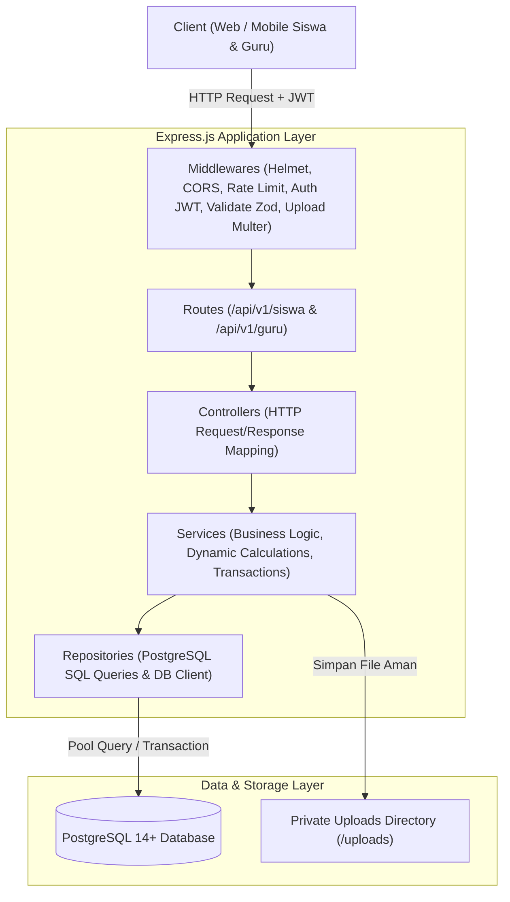
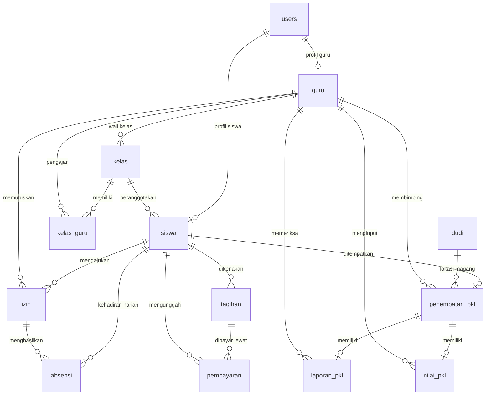

# Dokumentasi Lengkap Proyek: Backend Web Portal Siswa

Dokumen ini memuat seluruh spesifikasi teknis, rancangan arsitektur, skema database, aturan bisnis, keamanan, katalog endpoint API, serta panduan operasional untuk **Backend Web Portal Siswa**.

---

## 1. Ringkasan & Ruang Lingkup Proyek

### 1.1 Informasi Umum
- **Nama Proyek:** Backend Web Portal Siswa (PKM)
- **Versi:** 1.0.0
- **Teknologi Utama:** Node.js (v20+ / v26), Express.js, TypeScript, PostgreSQL (v14+)
- **Base URL API:** `/api/v1`
- **Format Pertukaran Data:** JSON (`application/json`) dan Multipart Form (`multipart/form-data`)

### 1.2 Ruang Lingkup (Scope)
- **In-Scope:**
  - 19 Endpoint API: 9 Endpoint Siswa dan 10 Endpoint Guru.
  - 3 Domain Bisnis: **PKL** (Praktik Kerja Lapangan), **Absensi & Pengajuan Izin**, dan **Keuangan / Tagihan**.
  - Otorisasi berlapis: Role-Based Access Control (RBAC) dan Relational Access Control (otorisasi berbasis relasi data).
  - Pengelolaan berkas unggahan: Laporan PKL (PDF), Surat Izin (PDF/JPG/PNG), dan Bukti Pembayaran (JPG/PNG) dengan validasi MIME dan *magic bytes*.
  - Kalkulasi status dinamis di server (tidak menyimpan status basi di database).
- **Out-of-Scope:**
  - Modul login/registrasi (diasumsikan token JWT sudah diterbitkan oleh auth provider).
  - Modul admin TU / Verifikasi pembayaran (data master dikelola via seeder).
  - Payment gateway otomatis (pembayaran sepenuhnya manual berbasis transfer).

---

## 2. Arsitektur Sistem

Arsitektur aplikasi menerapkan pola pemisahan tanggung jawab (*Separation of Concerns*) berbasis 4 lapis (**`routes → controllers → services → repositories`**):



### 2.1 Peran Tiap Lapisan
1. **Middlewares:**
   - `auth.ts`: Memeriksa keberadaan header `Authorization: Bearer <token>`, memverifikasi token JWT, mengekstrak `userId` dan `role`, serta memblokir role yang tidak sesuai (`401`/`403`).
   - `validate.ts`: Memvalidasi `body`, `query`, dan `params` menggunakan skema **Zod**. Mengembalikan `422 VALIDATION_ERROR` dengan rincian field jika gagal.
   - `upload.ts`: Mengatur penyimpanan file dengan nama acak (UUID/timestamp) dan memeriksa integritas header file (**Magic Bytes**) lewat pustaka `file-type`.
   - `errorHandler.ts`: Menangkap error terpusat dan memetakan kode status HTTP (`400`, `401`, `403`, `404`, `422`, `500`).
2. **Routes:** Mendefinisikan endpoint URL, mengaitkan middleware otorisasi role, upload handler, dan skema validasi.
3. **Controllers:** Mengekstrak parameter dari request, memanggil service layer, dan memformat respon sukses (`{ data }` dan `{ meta }`).
4. **Services:** Menjalankan aturan bisnis inti, kalkulasi dinamis (status PKL, progres durasi, jatuh tempo tagihan, bobot nilai akhir), dan orkestrasi transaksi DB.
5. **Repositories:** Mengisolasi query SQL mentah menggunakan connection pool `pg.Pool` dengan parameterized query (`$1`, `$2`) untuk mencegah SQL Injection.

---

## 3. Skema & Model Database (PostgreSQL)

### 3.1 Entity Relationship Diagram (ERD)



### 3.2 Kamus Data & Struktur Tabel

| Tabel | Kolom Utama | Deskripsi & Constraints |
|---|---|---|
| `users` | `id` (UUID PK), `username` (UK), `password_hash`, `role` | Akun pengguna (`role_user`: `'siswa'` / `'guru'`). |
| `guru` | `id` (UUID PK), `user_id` (FK), `nip` (UK), `nama`, `kontak` | Profil guru dan nomor kontak resmi. |
| `kelas` | `id` (UUID PK), `nama`, `tahun_ajaran`, `wali_kelas_id` (FK) | Data rombel dan wali kelas penanggung jawab. |
| `kelas_guru` | `kelas_id` (PK, FK), `guru_id` (PK, FK) | Relasi guru sebagai pengajar mata pelajaran di kelas. |
| `siswa` | `id` (UUID PK), `user_id` (FK), `nis` (UK), `nama`, `kelas_id` (FK) | Data siswa terdaftar dalam suatu kelas. |
| `semester` | `id` (UUID PK), `tahun_ajaran`, `nama`, `tanggal_mulai`, `tanggal_selesai` | Kalender akademik (`jenis_semester`: `'ganjil'` / `'genap'`). |
| `dudi` | `id` (UUID PK), `nama`, `alamat`, `nama_pembimbing`, `kontak_pembimbing` | Data Dunia Usaha / Dunia Industri mitra PKL. |
| `penempatan_pkl` | `id` (UUID PK), `siswa_id` (FK UK), `dudi_id` (FK), `guru_pembimbing_id` (FK), `tanggal_mulai`, `tanggal_selesai` | Penempatan magang siswa (satu siswa maksimal 1 penempatan aktif). |
| `laporan_pkl` | `id` (UUID PK), `penempatan_id` (FK UK), `file_path`, `status`, `catatan`, `diperiksa_oleh` (FK) | Laporan akhir PKL siswa (`status_laporan`: `'menunggu'`, `'disetujui'`, `'revisi'`). |
| `nilai_pkl` | `id` (UUID PK), `penempatan_id` (FK UK), `nilai_sikap`, `nilai_keterampilan`, `nilai_kedisiplinan`, `nilai_sekolah`, `nilai_akhir` | Nilai akhir gabungan (rentang 0–100). |
| `absensi` | `id` (UUID PK), `siswa_id` (FK), `tanggal` (DATE), `status`, `izin_id` (FK), `dicatat_oleh` (FK) | Kehadiran (`status_absensi`: `'hadir'`, `'izin'`, `'sakit'`, `'alpa'`). `UNIQUE (siswa_id, tanggal)`. |
| `izin` | `id` (UUID PK), `siswa_id` (FK), `jenis`, `tanggal_mulai`, `tanggal_selesai`, `lampiran_path`, `status`, `catatan`, `diputuskan_oleh` (FK) | Surat izin (`jenis_izin`: `'izin'`, `'sakit'`; `status_izin`: `'menunggu'`, `'disetujui'`, `'ditolak'`). |
| `tagihan` | `id` (UUID PK), `siswa_id` (FK), `komponen`, `keterangan`, `nominal`, `jatuh_tempo`, `lunas_pada` | Tagihan biaya sekolah (`komponen_tagihan`: `'SPP'`, `'BAHAN_PRAKTIKUM'`, `'UKK'`). |
| `pembayaran` | `id` (UUID PK), `tagihan_id` (FK), `siswa_id` (FK), `nominal`, `tanggal_transfer`, `bukti_path`, `status` | Bukti bayar yang diunggah siswa (`status_pembayaran`: `'menunggu'`, `'diverifikasi'`, `'ditolak'`). |
| `info_pembayaran` | `id` (PK = 1), `nama_bank`, `nomor_rekening`, `nama_penerima`, `jadwal_loket` | Konfigurasi rekening sekolah untuk pembayaran manual (hanya 1 baris). |

---

## 4. Otorisasi & Aturan Keamanan

### 4.1 Model Otorisasi Berlapis
1. **Otorisasi Role (RBAC):**
   - Siswa hanya dapat mengakses endpoint `/api/v1/siswa/*`.
   - Guru hanya dapat mengakses endpoint `/api/v1/guru/*`.
   - Pelanggaran role langsung ditolak dengan status **`403 FORBIDDEN`**.
2. **Otorisasi Relasi Data (Relationship-Based Access Control):**
   - **Siswa:** Identitas diambil **hanya dari token JWT** (`req.user.userId`). Siswa tidak dapat mengirim atau memanipulasi `siswaId` di URL/body untuk melihat data siswa lain.
   - **Guru Pembimbing:** Hanya guru yang terdaftar pada `penempatan_pkl.guru_pembimbing_id` yang dapat melihat siswa bimbingan, membuka laporan, mereview laporan, dan menginput nilai.
   - **Wali Kelas & Guru Pengajar:** Mengakses kehadiran dan izin kelas diizinkan bila guru adalah `wali_kelas_id` atau terdaftar dalam `kelas_guru`.
   - **Keuangan Kelas:** Rekap status pembayaran kelas (`G-KEU-1`) dibatasi **hanya untuk wali kelas** (`kelas.wali_kelas_id`). Guru pengajar biasa akan ditolak dengan status `403`.

### 4.2 Pengamanan Berkas Unggahan
- File disimpan di luar folder publik (`uploads/`). Akses file hanya dapat dilakukan melalui endpoint API berautentikasi.
- Nama file asli di-rename secara acak menggunakan *timestamp* dan *cryptographic hex* untuk mencegah *path traversal* atau penebakan nama file.
- **Validasi Magic Bytes:** Menggunakan pustaka `file-type` untuk memeriksa signature biner file secara langsung. Jika file `.exe` atau skrip berbahaya sengaja diubah ekstensinya menjadi `.pdf` atau `.png`, upload otomatis dibatalkan, file dihapus dari disk, dan server mengembalikan status `422 FILE_TYPE_INVALID`.

### 4.3 Format Respon Terstandarisasi

- **Respon Sukses:**
  ```json
  {
    "data": { ... }
  }
  ```
  *(Untuk endpoint berpaginasi, ditambahkan objek `"meta": { "page": 1, "limit": 20, "total": 32 }`)*

- **Respon Gagal / Error:**
  ```json
  {
    "error": {
      "code": "KODE_ERROR",
      "message": "Pesan deskripsi kesalahan",
      "details": [
        { "field": "namaField", "message": "Penyebab kegagalan validasi" }
      ]
    }
  }
  ```

---

## 5. Katalog Lengkap Endpoint API

### 5.1 Endpoint Domain Siswa (Role: `siswa`)

#### S-PKL-1: GET `/api/v1/siswa/pkl`
- **Fungsi:** Menampilkan status penempatan PKL siswa, industri, kontak pembimbing, periode, dan progres bulan.
- **Aturan:**
  - Status dihitung dinamis: `Belum Dimulai` (hari ini < tanggalMulai), `Aktif` (di dalam rentang), `Selesai` (hari ini > tanggalSelesai).
  - Progres bulan: `bulanKe` (0 untuk Belum Dimulai, bulan berjalan untuk Aktif, `totalBulan` untuk Selesai).
  - `laporan`: status dan catatan laporan akhir (`null` bila belum upload, `{ status, catatan }` bila sudah diupload).
- **Respon 200:**
  ```json
  {
    "data": {
      "status": "Aktif",
      "industri": { "nama": "PT Teknologi Nusantara", "alamat": "Jl. Merdeka No. 10, Tangerang Selatan" },
      "pembimbingIndustri": { "nama": "Budi Santoso", "kontak": "081234567890" },
      "guruPembimbing": { "nama": "Siti Rahma, S.Pd", "kontak": "081298765432" },
      "periode": { "mulai": "2026-09-01", "selesai": "2026-11-30" },
      "progres": { "bulanKe": 3, "totalBulan": 3 },
      "laporan": { "status": "revisi", "catatan": "Bab 3 belum ada dokumentasi kegiatan." }
    }
  }
  ```
- **Error:** `401`, `403`, `404 PKL_NOT_FOUND`.

#### S-PKL-2: GET `/api/v1/siswa/pkl/nilai`
- **Fungsi:** Menampilkan nilai sikap, keterampilan, kedisiplinan, dan nilai akhir PKL.
- **Aturan:** Jika guru belum menginput nilai, server mengembalikan respon `200` dengan semua field bernilai `null` (bukan error).
- **Respon 200:**
  ```json
  {
    "data": {
      "sikap": 88,
      "keterampilan": 85.5,
      "kedisiplinan": 90,
      "nilaiAkhir": 87.6
    }
  }
  ```

#### S-PKL-3: POST `/api/v1/siswa/pkl/laporan`
- **Fungsi:** Mengunggah file laporan akhir PKL (Format: PDF, maks 10 MB).
- **Request:** `multipart/form-data`, field: `file`.
- **Aturan:**
  - Baru pertama upload: status menjadi `menunggu` (Respon `201`).
  - Laporan sudah ada dengan status `revisi`: file lama dihapus, diganti file baru, status kembali `menunggu` (Respon `200`).
  - Laporan sudah ada dengan status `menunggu` atau `disetujui`: `422 LAPORAN_TIDAK_DAPAT_DIUBAH`.

#### S-ABS-1: GET `/api/v1/siswa/absensi/rekap`
- **Fungsi:** Menampilkan rekap total hadir, izin, sakit, dan alpa.
- **Query Params:** Wajib mengirim tepat satu parameter: `bulan=YYYY-MM` ATAU `semester={mulai}-{selesai}-{ganjil|genap}` (contoh: `semester=2026-2027-ganjil`).
- **Respon 200:**
  ```json
  {
    "data": { "hadir": 20, "izin": 1, "sakit": 2, "alpa": 0 }
  }
  ```

#### S-ABS-2: POST `/api/v1/siswa/izin`
- **Fungsi:** Mengajukan surat izin / sakit.
- **Request:** `multipart/form-data`
  - `jenis`: `'izin'` | `'sakit'` (wajib)
  - `tanggalMulai`: `YYYY-MM-DD` (wajib)
  - `tanggalSelesai`: `YYYY-MM-DD` (wajib, tidak boleh sebelum tanggalMulai)
  - `keterangan`: string (opsional, maks 500 karakter)
  - `lampiran`: berkas file JPG, PNG, atau PDF (wajib, maks 5 MB)
- **Respon 201:** Status awal otomatis `menunggu`.

#### S-KEU-1: GET `/api/v1/siswa/tagihan`
- **Fungsi:** Menampilkan daftar rincian tagihan siswa dengan pagination (`page`, `limit`).
- **Filter:** `status` (`Lunas` | `Belum Lunas` | `Jatuh Tempo`).
- **Aturan:**
  - `Lunas`: `lunas_pada` terisi.
  - `Jatuh Tempo`: belum lunas dan `jatuh_tempo < hari ini`.
  - `Belum Lunas`: belum lunas dan belum melewati jatuh tempo. Filter ini tidak mencakup yang berstatus Jatuh Tempo.

#### S-KEU-2: GET `/api/v1/siswa/tagihan/ringkasan`
- **Fungsi:** Menjumlahkan seluruh tagihan yang belum lunas (termasuk yang berstatus jatuh tempo).
- **Respon 200:**
  ```json
  {
    "data": { "total": 850000 }
  }
  ```

#### S-KEU-3: GET `/api/v1/siswa/info-pembayaran`
- **Fungsi:** Mengambil data rekening sekolah dan jadwal loket TU dari tabel `info_pembayaran`.
- **Respon 200:**
  ```json
  {
    "data": {
      "namaBank": "Bank Contoh",
      "nomorRekening": "1234567890",
      "namaPenerima": "SMK Contoh Nusantara",
      "jadwalLoket": "Senin - Jumat, 08.00 - 14.00 WIB"
    }
  }
  ```

#### S-KEU-4: POST `/api/v1/siswa/pembayaran`
- **Fungsi:** Mengunggah bukti transfer pembayaran.
- **Request:** `multipart/form-data`
  - `tagihanId`: UUID (wajib, harus tagihan milik siswa yang login)
  - `nominal`: number (wajib, > 0)
  - `tanggalTransfer`: `YYYY-MM-DD` (wajib)
  - `bukti`: file gambar JPG / PNG (wajib, maks 5 MB)
- **Aturan:**
  - Jika tagihan bukan milik siswa atau ID salah: `404 TAGIHAN_NOT_FOUND` (tidak membocorkan keberadaan tagihan siswa lain).
  - Jika tagihan sudah lunas: `422 TAGIHAN_SUDAH_LUNAS`.

---

### 5.2 Endpoint Domain Guru (Role: `guru`)

#### G-PKL-1: GET `/api/v1/guru/pkl/siswa`
- **Fungsi:** Menampilkan daftar seluruh siswa yang dibimbing oleh guru pembimbing yang login.
- **Query Params:** `page` (default 1), `limit` (default 20, maks 100).
- **Respon 200:**
  ```json
  {
    "data": [
      {
        "siswaId": "7f1c...",
        "nis": "2324001",
        "nama": "Ahmad Fauzi",
        "statusPkl": "Aktif",
        "industri": { "nama": "PT Teknologi Nusantara", "alamat": "Jl. Merdeka No. 10" },
        "pembimbingIndustri": { "nama": "Budi Santoso", "kontak": "081234567890" },
        "laporan": { "id": "b3c1...", "status": "menunggu" }
      }
    ],
    "meta": { "page": 1, "limit": 20, "total": 8 }
  }
  ```

#### G-PKL-2: GET `/api/v1/guru/pkl/laporan/:id`
- **Fungsi:** Melihat detail laporan PKL siswa bimbingan.
- **Header:**
  - `Accept: application/json` (default): Mengembalikan metadata JSON.
  - `Accept: application/pdf`: Mengalirkan berkas PDF asli langsung ke peramban / client.
- **Aturan:** Laporan harus milik siswa bimbingan guru yang bersangkutan (`403` jika di luar relasi).

#### G-PKL-3: PATCH `/api/v1/guru/pkl/laporan/:id/review`
- **Fungsi:** Memberikan persetujuan atau catatan revisi pada laporan PKL.
- **Body JSON:**
  ```json
  {
    "status": "revisi",
    "catatan": "Bab 3 belum ada dokumentasi kegiatan."
  }
  ```
- **Aturan:**
  - `catatan` wajib diisi jika `status = 'revisi'`.
  - Hanya laporan dengan status `menunggu` yang dapat direview (`422 LAPORAN_TIDAK_DAPAT_DIREVIEW`).

#### G-PKL-4: PUT `/api/v1/guru/pkl/siswa/:siswaId/nilai`
- **Fungsi:** Memasukkan nilai akhir PKL (bersifat upsert).
- **Body JSON:**
  ```json
  {
    "nilaiSekolah": 85,
    "nilaiIndustri": { "sikap": 88, "keterampilan": 85.5, "kedisiplinan": 90 }
  }
  ```
- **Aturan:**
  - Semua nilai berada pada rentang 0 sampai 100.
  - `nilaiAkhir` dihitung otomatis oleh server menggunakan bobot konfigurasi:
    $$\text{Rata-Rata Industri} = \frac{\text{Sikap} + \text{Keterampilan} + \text{Kedisiplinan}}{3}$$
    $$\text{Nilai Akhir} = \frac{(\text{Nilai Sekolah} \times \text{Bobot Sekolah}) + (\text{Rata-Rata Industri} \times \text{Bobot Industri})}{100}$$

#### G-ABS-1: GET `/api/v1/guru/kelas/:kelasId/absensi/rekap`
- **Fungsi:** Rekap absensi bulanan seluruh siswa di dalam satu rombel kelas.
- **Query Params:** `bulan=YYYY-MM` (wajib), `page`, `limit`.
- **Aturan:** Guru harus wali kelas atau pengajar yang terdaftar di kelas tersebut (`403` jika bukan).

#### G-ABS-2: POST `/api/v1/guru/kelas/:kelasId/absensi`
- **Fungsi:** Menginput kehadiran kelas harian secara massal.
- **Body JSON:**
  ```json
  {
    "tanggal": "2026-11-10",
    "data": [
      { "siswaId": "7f1c...", "status": "hadir" },
      { "siswaId": "0a9b...", "status": "alpa" }
    ]
  }
  ```
- **Aturan:**
  - Tanggal tidak boleh di masa depan.
  - Semua `siswaId` harus valid anggota kelas (`422 SISWA_BUKAN_ANGGOTA_KELAS`).
  - Tidak boleh ada `siswaId` ganda di dalam request yang sama (`422 SISWA_DUPLIKAT`).
  - Bersifat upsert dalam satu transaksi database atomik (gagal satu = gagal semua).

#### G-ABS-3: GET `/api/v1/guru/izin`
- **Fungsi:** Menampilkan daftar pengajuan izin dari siswa di kelas yang diampu atau diajar oleh guru yang login.
- **Query Params:** `status` (`menunggu` | `disetujui` | `ditolak`), `kelasId` (UUID), `page`, `limit`.
- **Aturan:** `kelasId` harus kelas yang diampu atau diajar (`403` jika di luar relasi). Diurutkan dari yang terbaru.
- **Respon 200:**
  ```json
  {
    "data": [
      {
        "id": "e91a...",
        "siswa": { "id": "7f1c...", "nis": "2324001", "nama": "Ahmad Fauzi", "kelas": "XII TKJ 1" },
        "jenis": "sakit",
        "tanggalMulai": "2026-11-12",
        "tanggalSelesai": "2026-11-13",
        "status": "menunggu",
        "dibuatPada": "2026-11-11T08:30:00Z"
      }
    ],
    "meta": { "page": 1, "limit": 20, "total": 3 }
  }
  ```

#### G-ABS-4: GET `/api/v1/guru/izin/:id`
- **Fungsi:** Melihat detail permohonan izin siswa dan streaming lampiran file.
- **Header:** Mendukung streaming gambar (`image/jpeg`, `image/png`) atau PDF (`application/pdf`) via header `Accept`.

#### G-ABS-5: PATCH `/api/v1/guru/izin/:id/keputusan`
- **Fungsi:** Menyetujui atau menolak permohonan izin.
- **Body JSON:** `{ "status": "disetujui", "catatan": "Disetujui wali kelas" }`
- **Aturan & Efek Samping Transaksi:**
  - `catatan` wajib diisi bila status adalah `ditolak`.
  - Izin yang sudah diputuskan tidak dapat diputuskan ulang (`422 IZIN_SUDAH_DIPUTUSKAN`).
  - Bila `status = 'disetujui'`: Dalam **satu transaksi database**, server meng-update status izin dan secara otomatis meng-upsert baris absensi untuk setiap tanggal pada rentang izin tersebut menjadi status `izin` atau `sakit` sesuai jenisnya, lengkap dengan mengisi referensi `izin_id`.

#### G-KEU-1: GET `/api/v1/guru/kelas/:kelasId/tagihan/status`
- **Fungsi:** Melihat status pembayaran per siswa di kelas (Read-Only).
- **Aturan Khusus:** **Hanya Wali Kelas** yang diizinkan mengakses. Guru pengajar biasa akan ditolak dengan `403 FORBIDDEN`.
- **Respon 200:**
  ```json
  {
    "data": [
      { "siswaId": "7f1c...", "nama": "Ahmad Fauzi", "status": "Lunas" },
      { "siswaId": "0a9b...", "nama": "Dewi Lestari", "status": "Belum Lunas" }
    ],
    "meta": { "page": 1, "limit": 20, "total": 2 }
  }
  ```

---

## 6. Daftar Kode Status & Kode Error

| HTTP | Kode Error | Skenario Pemunculan |
|---|---|---|
| `400` | `BAD_REQUEST` | Format JSON request rusak atau berkas wajib tidak dilampirkan. |
| `401` | `UNAUTHORIZED` | Token JWT tidak disertakan, format tidak valid, atau telah kedaluwarsa. |
| `403` | `FORBIDDEN` | Role tidak berhak, atau guru mengakses siswa/kelas di luar relasinya. |
| `404` | `NOT_FOUND` | Data spesifik tidak ditemukan. |
| `404` | `PKL_NOT_FOUND` | Siswa belum memiliki penempatan magang PKL. |
| `404` | `TAGIHAN_NOT_FOUND` | Tagihan tidak ditemukan atau bukan milik siswa bersangkutan. |
| `422` | `VALIDATION_ERROR` | Validasi skema input Zod gagal (dikirim beserta array `details`). |
| `422` | `FILE_TYPE_INVALID` | Magic bytes atau MIME file tidak sesuai ketentuan. |
| `422` | `FILE_TOO_LARGE` | Berkas melebihi batas ukuran (PDF 10 MB, Gambar 5 MB). |
| `422` | `LAPORAN_TIDAK_DAPAT_DIUBAH` | Siswa mencoba upload laporan saat status masih `menunggu` atau `disetujui`. |
| `422` | `LAPORAN_TIDAK_DAPAT_DIREVIEW` | Guru mereview laporan yang statusnya bukan `menunggu`. |
| `422` | `IZIN_SUDAH_DIPUTUSKAN` | Guru mencoba memutuskan izin yang sudah berstatus `disetujui`/`ditolak`. |
| `422` | `TAGIHAN_SUDAH_LUNAS` | Siswa mengunggah bukti bayar untuk tagihan yang sudah lunas. |
| `422` | `SISWA_BUKAN_ANGGOTA_KELAS` | Input absensi kelas memuat siswa yang bukan anggota rombel tersebut. |
| `422` | `SISWA_DUPLIKAT` | Input absensi memuat ID siswa yang sama lebih dari satu kali. |
| `500` | `INTERNAL_ERROR` | Kesalahan sistem tak terduga. |

---

## 7. Referensi Akun Uji Coba (Seeder Data)

Data awal disediakan pada file [`seed.sql`](./seed.sql) untuk pengujian lokal:

| Role | Username | Password | Deskripsi / Posisi |
|---|---|---|---|
| **Siswa** | `siswa1` | `password123` | Ahmad Fauzi (XII TKJ 1) – Memiliki penempatan PKL aktif & tagihan SPP jatuh tempo. |
| **Siswa** | `siswa2` | `password123` | Dewi Lestari (XII TKJ 1) – Belum memiliki penempatan PKL, tagihan SPP lunas. |
| **Guru** | `guru1` | `password123` | Siti Rahma, S.Pd – **Wali Kelas XII TKJ 1** dan **Guru Pembimbing PKL** Ahmad Fauzi. |
| **Guru** | `guru2` | `password123` | Joko Purwanto, M.Kom – Guru Pengajar kelas XII TKJ 1 (bukan wali kelas). |
| **Guru** | `guru3` | `password123` | Hendra Pratama, S.T – Guru dari rombel lain (luar relasi / akun uji coba 403). |

---

## 8. Panduan Menjalankan & Pengujian

### 8.1 Instalasi & Konfigurasi
```bash
# 1. Instalasi dependensi
npm install

# 2. Setup konfigurasi .env
cp .env.example .env
```

### 8.2 Eksekusi Skema & Seeder Database
```bash
# Inisialisasi tabel di PostgreSQL:
psql -U postgres -d portal_siswa -f schema.sql

# Isi data seeder awal:
npm run seed
# atau langsung via psql:
psql -U postgres -d portal_siswa -f seed.sql
```

### 8.3 Menjalankan Aplikasi
```bash
# Mode pengembangan (auto-reload via tsx):
npm run dev

# Kompilasi TypeScript ke folder dist/:
npm run build

# Menjalankan build produksi:
npm start
```

### 8.4 Menjalankan Automated Tests
```bash
npm test
```
*Test suite Vitest mencakup 18 skenario pengujian menyeluruh (kasus sukses, otorisasi relasi data, proteksi role 403, validasi Zod 422, dan aturan bisnis).*
