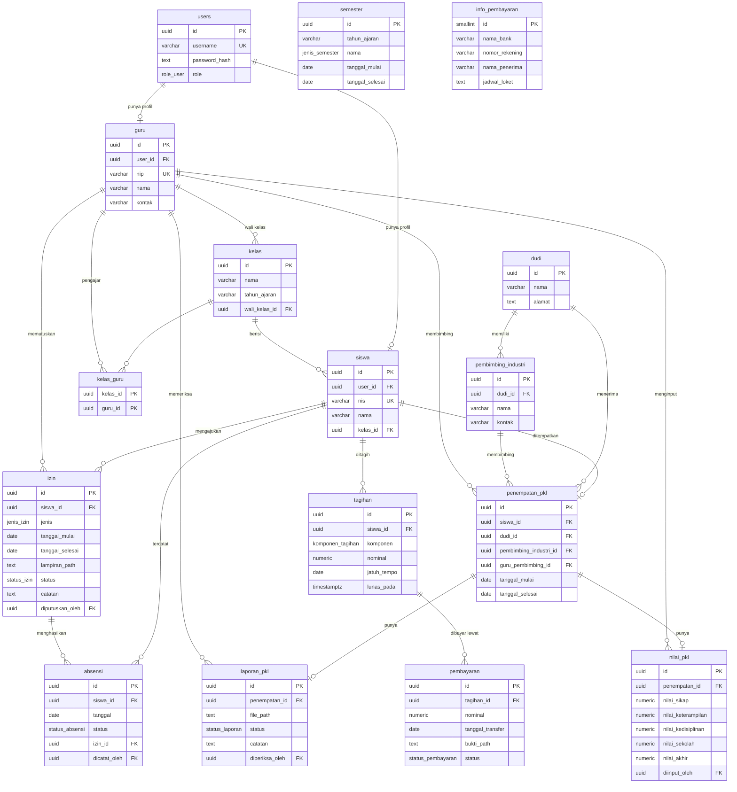

# ERD dan Skema Database v2.0: Web Portal Siswa

DBMS: PostgreSQL 14+. DDL lengkap ada di `schema.sql`. Sinkron dengan `PRD-Portal-Siswa-v2.md` dan `API-Spec-v2.md`.

## 0. Hasil Audit: Apa yang Berubah dari v1

**Perubahan fitur v2 (`GET /guru/izin`, blok `laporan` di `S-PKL-1`) tidak mengubah struktur tabel.** Keduanya hanya query baru atas tabel yang sudah ada. Perubahan di bawah ini datang dari audit ulang skema terhadap seluruh PRD dan API v2.

| # | Perubahan | Jenis | Alasan |
|---|---|---|---|
| 1 | Tabel baru `pembimbing_industri`. Kolom `nama_pembimbing` dan `kontak_pembimbing` dihapus dari `dudi` | Struktural | Di v1 satu DUDI hanya bisa punya satu pembimbing. Kenyataannya satu perusahaan sering membimbing beberapa siswa dengan pembimbing berbeda |
| 2 | `penempatan_pkl.pembimbing_industri_id` ditambah, dengan **FK komposit** `(pembimbing_industri_id, dudi_id)` | Struktural | Menjamin pembimbing yang dipilih benar-benar berasal dari DUDI penempatan itu |
| 3 | `pembayaran.siswa_id` dihapus | Struktural | Redundan dengan `tagihan.siswa_id` dan bisa tidak cocok (bukti siswa A menempel ke tagihan siswa B). Pemilik kini hanya lewat `tagihan` |
| 4 | `CHECK` pada `laporan_pkl`: `(status='menunggu') = (diperiksa_pada IS NULL)` | Integritas | Mencegah status dan data pemeriksaan saling bertentangan |
| 5 | `CHECK` pada `izin`: `(status='menunggu') = (diputuskan_pada IS NULL)` | Integritas | Sama seperti di atas, untuk izin |
| 6 | `CHECK` pada `absensi`: `izin_id` hanya boleh terisi bila status `izin` atau `sakit` | Integritas | Absensi hasil izin tidak mungkin berstatus `hadir` atau `alpa` |
| 7 | Index baru: `izin(status, dibuat_pada DESC)`, `kelas(wali_kelas_id)`, `kelas_guru(guru_id)`. Index `tagihan` jadi komposit `(siswa_id, lunas_pada, jatuh_tempo)` | Performa | Melayani `G-ABS-3`, pengecekan akses kelas, dan status tagihan turunan |

**Dampak ke API:** tidak ada. Response `pembimbingIndustri` di `S-PKL-1` dan `G-PKL-1` tetap sama, hanya sumber join-nya berpindah ke `pembimbing_industri`.

**Aturan service baru akibat CHECK (#4):** saat siswa upload ulang laporan berstatus `revisi`, service wajib mengosongkan `catatan`, `diperiksa_oleh`, dan `diperiksa_pada`, lalu set status `menunggu`. Kalau tidak, database akan menolak update.

**Dicek dan sengaja tidak diubah**

| Hal | Kenapa dibiarkan |
|---|---|
| `siswa.kelas_id` hanya kelas saat ini, tanpa riwayat kelas | PRD tidak butuh riwayat. Konsekuensi: setelah siswa naik kelas, wali kelas lama tidak lagi melihat data siswa itu |
| `tahun_ajaran` berupa string di `kelas` dan `semester` | Tabel tersendiri berlebihan untuk scope ini |
| `nilai_akhir` disimpan, bobot di config | Bobot belum final. Kalau bobot berubah, nilai lama tidak dihitung ulang otomatis |
| Boleh ada beberapa bukti `menunggu` untuk satu tagihan | PRD tidak melarang. Bisa dibatasi dengan partial unique index bila diputuskan |
| Tidak ada tabel file | Cukup kolom `*_path` |

## 1. ERD



`semester` dan `info_pembayaran` berdiri sendiri (tanpa relasi FK).

## 2. Keputusan Desain

| Keputusan | Alasan |
|---|---|
| Status PKL, progres durasi, dan *Jatuh Tempo* **tidak disimpan** | Sesuai PRD: dihitung dari tanggal saat request, tidak ada data basi |
| `tagihan.lunas_pada` (timestamp) menggantikan kolom status | Satu sumber kebenaran. Lunas = tidak null |
| `absensi UNIQUE (siswa_id, tanggal)` | Menegakkan aturan "satu record per siswa per tanggal" di level database |
| `absensi.izin_id` | Menelusuri record absensi yang lahir dari izin yang disetujui |
| `laporan_pkl.penempatan_id UNIQUE` | Satu laporan per penempatan. Upload ulang meng-update baris yang sama |
| `nilai_pkl.nilai_akhir` disimpan | Hasil hitung server saat input. Bobot ada di config aplikasi, bukan di DB |
| `kelas_guru` terpisah dari `kelas.wali_kelas_id` | Wali kelas dan guru pengajar punya hak akses berbeda (keuangan hanya wali kelas) |
| `pembayaran.tagihan_id` tunggal, tanpa `siswa_id` | Satu bukti = satu tagihan (body S-KEU-4). Pemilik selalu lewat `tagihan.siswa_id` |
| `pembimbing_industri` terpisah dari `dudi`, dikunci FK komposit | Satu DUDI bisa punya banyak pembimbing, dan pembimbing wajib sah untuk DUDI penempatan |
| `info_pembayaran` dibatasi satu baris (`CHECK id = 1`) | Konfigurasi sekolah, bukan data transaksional |
| `users` hanya `username, password_hash, role` | Cukup untuk JWT. Autentikasi di luar scope PRD, tabel ini boleh diganti |
| `ON DELETE RESTRICT` untuk data master, `CASCADE` untuk data turunan | Mencegah master terhapus tak sengaja, tapi hapus siswa ikut membersihkan datanya |

## 3. Keputusan Skema atas Pertanyaan Terbuka PRD v2

| PRD v2 Bagian 13 | Keputusan di skema |
|---|---|
| #1 Bobot nilai akhir | Tidak di DB. Simpan `nilai_sekolah` dan tiga nilai industri, bobot di config aplikasi |
| #2 Pengisi master data | Seeder. Admin TU di luar scope |
| #3 Riwayat izin dan bukti bayar untuk siswa | Skema sudah mendukung (`izin.siswa_id`, `tagihan` + `pembayaran`). Tinggal menambah endpoint bila diputuskan |
| #4 Kapan siswa dihitung `alpa` | Tidak otomatis. `alpa` hanya dari input guru, tidak ada baris = belum tercatat |

Keputusan lama yang tetap: upload ulang laporan hanya saat `revisi`, dan satu bukti untuk satu tagihan.

## 4. Query Turunan

**Status PKL**

```sql
SELECT CASE
         WHEN CURRENT_DATE < tanggal_mulai   THEN 'Belum Dimulai'
         WHEN CURRENT_DATE > tanggal_selesai THEN 'Selesai'
         ELSE 'Aktif'
       END AS status
FROM penempatan_pkl WHERE siswa_id = $1;
```

**Status tagihan**

```sql
SELECT id, komponen, nominal,
       CASE
         WHEN lunas_pada IS NOT NULL         THEN 'Lunas'
         WHEN jatuh_tempo < CURRENT_DATE     THEN 'Jatuh Tempo'
         ELSE 'Belum Lunas'
       END AS status
FROM tagihan WHERE siswa_id = $1;
```

**Total tagihan belum lunas**

```sql
SELECT COALESCE(SUM(nominal), 0) AS total
FROM tagihan WHERE siswa_id = $1 AND lunas_pada IS NULL;
```

**Rekap absensi per bulan**

```sql
SELECT
  COUNT(*) FILTER (WHERE status = 'hadir') AS hadir,
  COUNT(*) FILTER (WHERE status = 'izin')  AS izin,
  COUNT(*) FILTER (WHERE status = 'sakit') AS sakit,
  COUNT(*) FILTER (WHERE status = 'alpa')  AS alpa
FROM absensi
WHERE siswa_id = $1
  AND tanggal >= $2 AND tanggal < $3;   -- awal dan akhir bulan
```

**Rekap absensi per semester** sama seperti di atas, dengan rentang tanggal diambil dari tabel `semester`.

**Cek otorisasi guru pembimbing**

```sql
SELECT 1 FROM penempatan_pkl
WHERE siswa_id = $1 AND guru_pembimbing_id = $2;   -- kosong = 403
```

**Cek akses kelas** (wali kelas atau pengajar)

```sql
SELECT 1 FROM kelas k
LEFT JOIN kelas_guru kg ON kg.kelas_id = k.id AND kg.guru_id = $2
WHERE k.id = $1 AND (k.wali_kelas_id = $2 OR kg.guru_id IS NOT NULL);
```

Untuk endpoint keuangan (G-KEU-1) pakai `k.wali_kelas_id = $2` saja.

**Daftar izin untuk guru (`G-ABS-3`)**

```sql
SELECT i.id, i.jenis, i.tanggal_mulai, i.tanggal_selesai, i.status, i.dibuat_pada,
       s.id AS siswa_id, s.nis, s.nama, k.nama AS kelas
FROM izin i
JOIN siswa s ON s.id = i.siswa_id
JOIN kelas k ON k.id = s.kelas_id
LEFT JOIN kelas_guru kg ON kg.kelas_id = k.id AND kg.guru_id = $1
WHERE (k.wali_kelas_id = $1 OR kg.guru_id IS NOT NULL)
  AND ($2::status_izin IS NULL OR i.status = $2)
  AND ($3::uuid        IS NULL OR k.id = $3)
ORDER BY i.dibuat_pada DESC
LIMIT $4 OFFSET $5;
```

**Daftar siswa bimbingan (`G-PKL-1`)**

```sql
SELECT s.id AS siswa_id, s.nis, s.nama,
       d.nama AS industri, d.alamat,
       pi.nama AS pembimbing, pi.kontak AS kontak_pembimbing,
       p.tanggal_mulai, p.tanggal_selesai,
       l.id AS laporan_id, l.status AS laporan_status
FROM penempatan_pkl p
JOIN siswa s               ON s.id  = p.siswa_id
JOIN dudi d                ON d.id  = p.dudi_id
JOIN pembimbing_industri pi ON pi.id = p.pembimbing_industri_id
LEFT JOIN laporan_pkl l    ON l.penempatan_id = p.id
WHERE p.guru_pembimbing_id = $1
ORDER BY s.nama
LIMIT $2 OFFSET $3;
```

**Status pembayaran kelas (`G-KEU-1`)**

```sql
SELECT s.id AS siswa_id, s.nama,
       CASE WHEN EXISTS (SELECT 1 FROM tagihan t
                         WHERE t.siswa_id = s.id AND t.lunas_pada IS NULL)
            THEN 'Belum Lunas' ELSE 'Lunas' END AS status
FROM siswa s
JOIN kelas k ON k.id = s.kelas_id
WHERE k.id = $1 AND k.wali_kelas_id = $2
ORDER BY s.nama
LIMIT $3 OFFSET $4;
```

**Kepemilikan tagihan saat upload bukti (`S-KEU-4`)**

```sql
SELECT 1 FROM tagihan
WHERE id = $1 AND siswa_id = $2 AND lunas_pada IS NULL;  -- kosong: 404 atau 422, cek terpisah
```

## 5. Catatan Implementasi

- `gen_random_uuid()` bawaan PostgreSQL 13+. Di versi lebih lama aktifkan `pgcrypto`.
- Kalau pakai Prisma atau Drizzle, skema ini bisa diterjemahkan langsung. Enum PostgreSQL dipetakan ke enum ORM.
- Saat izin disetujui, lakukan dalam **satu transaksi**: update `izin.status`, lalu upsert `absensi` untuk tiap tanggal pada rentang izin (`ON CONFLICT (siswa_id, tanggal) DO UPDATE`).
- Upload ulang laporan: satu `UPDATE` yang mengganti `file_path`, `status = 'menunggu'`, dan mengosongkan `catatan`, `diperiksa_oleh`, `diperiksa_pada`. Kalau salah satu tertinggal, `CHECK` akan menolak.
- Simpan hanya **path relatif** file di kolom `*_path`, bukan URL publik. Akses file tetap lewat endpoint ber-otorisasi.
