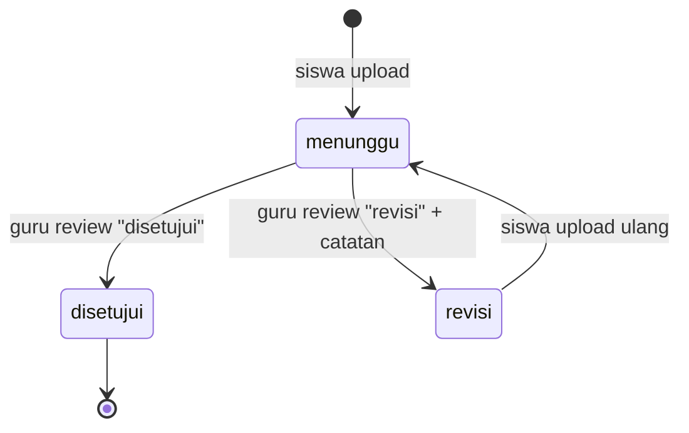
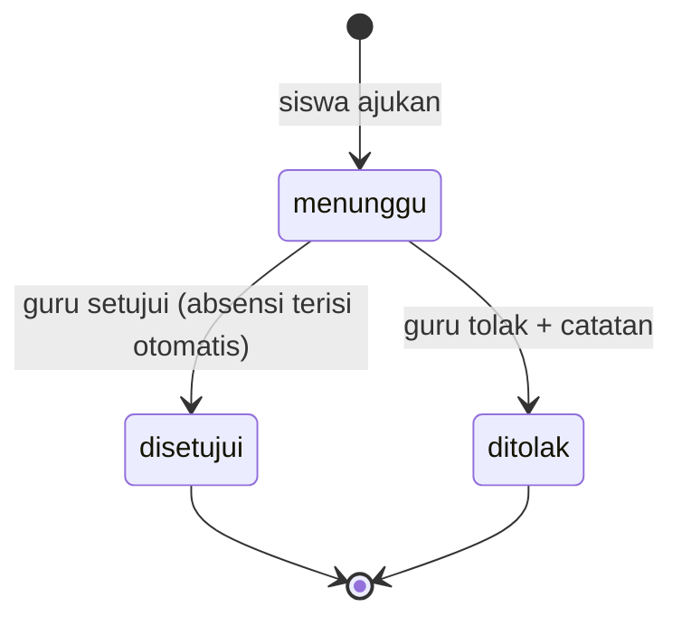
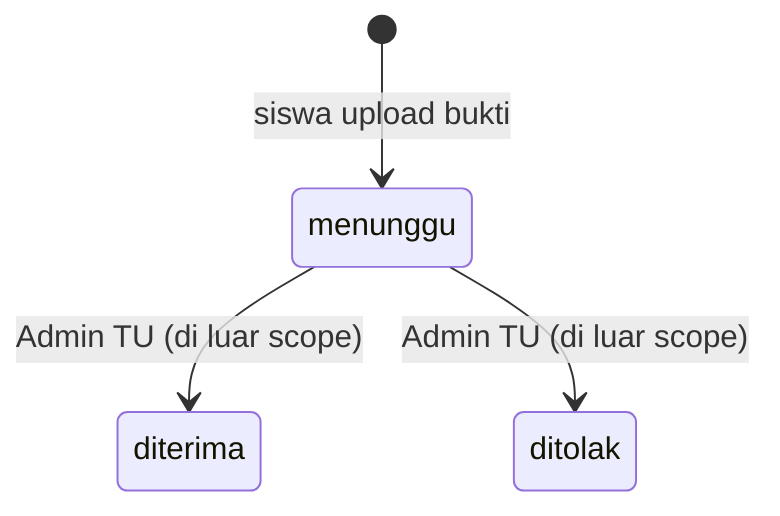

# PRD v2.0: Backend Web Portal Siswa

**Stack:** Express.js (Node.js) + PostgreSQL | **Base URL:** `/api/v1`
**Dokumen pasangan:** `API-Spec-v2.md` (kontrak endpoint), `schema.sql` dan `ERD-Skema-DB.md` (database)

## Perubahan dari v1

| Perubahan | Alasan |
|---|---|
| Setiap butir fitur dipetakan ke endpoint (Bagian 4) | Memastikan tidak ada fitur yang terlewat |
| User story dan acceptance criteria per fitur (Bagian 5) | Acuan uji yang bisa diperiksa satu per satu |
| Diagram status laporan, izin, pembayaran (Bagian 6) | Alur status yang jelas |
| Matriks otorisasi lengkap (Bagian 7) | Area bug paling berbahaya |
| Rencana pengujian dan milestone (Bagian 11, 14) | Siap dikerjakan |
| `GET /guru/izin` ditambahkan (G-ABS-3) | Fitur "melihat pengajuan izin" tidak bisa dipakai tanpa daftar |
| `S-PKL-1` memuat status dan catatan laporan | Siswa perlu melihat catatan revisi sebelum upload ulang |

---

## 1. Ringkasan dan Tujuan

Backend REST API untuk Web Portal Siswa dengan dua kelompok pengguna, **Siswa** dan **Guru**, dan tiga domain: **PKL**, **Absensi**, **Keuangan**.

**Tujuan**

1. Siswa memantau PKL, kehadiran, dan tagihan lewat satu portal.
2. Siswa mengirim dokumen: laporan PKL, surat izin, bukti pembayaran.
3. Guru memvalidasi laporan PKL, mengelola kehadiran dan izin, serta memantau status pembayaran kelas.

**Kriteria keberhasilan**

| Kriteria | Ukuran |
|---|---|
| Isolasi data | 0 kasus siswa atau guru bisa membaca data di luar relasinya (diuji otomatis) |
| Kebenaran status | Status PKL, *Jatuh Tempo*, dan progres durasi selalu sesuai tanggal saat request |
| Kelengkapan fitur | 14 fitur pada Bagian 4 seluruhnya punya endpoint dan lulus acceptance criteria |
| Keamanan file | Semua file ditolak bila MIME, magic bytes, atau ukuran tidak sesuai |
| Responsivitas | Target p95 di bawah 500 ms untuk endpoint non-upload pada data sekolah tunggal |

## 2. Pengguna

| Pengguna | Tujuan utama | Dasar akses |
|---|---|---|
| **Siswa** | Memantau dan melengkapi kewajiban PKL, kehadiran, pembayaran | Data milik sendiri (dari token) |
| **Guru Pembimbing PKL** | Memantau dan menilai siswa bimbingan | `penempatan_pkl.guru_pembimbing_id` |
| **Wali Kelas** | Mengelola absensi, izin, dan memantau pembayaran kelas | `kelas.wali_kelas_id` |
| **Guru Pengajar** | Mengelola absensi dan izin kelas yang diajar | `kelas_guru` |
| *Admin TU* | Memverifikasi bukti bayar, mengelola master data | **Di luar scope**, hanya aktor eksternal |

Satu guru bisa memegang beberapa peran sekaligus. Peran ditentukan oleh **relasi data**, bukan role token (token hanya `siswa` atau `guru`).

## 3. Scope

**In scope**

- 19 endpoint: 9 siswa, 10 guru.
- Upload file: laporan PKL (PDF), surat izin (JPG/PNG/PDF), bukti pembayaran (JPG/PNG).
- Otorisasi berbasis role **dan** relasi data.
- Seeder untuk data awal dan akun uji.

**Out of scope**

- Autentikasi (login, refresh, logout). Diasumsikan menghasilkan JWT berisi `userId` dan `role`.
- Seluruh fitur Admin TU, termasuk verifikasi bukti bayar dan pengelolaan master data.
- Payment gateway. Pembayaran 100% manual.
- Notifikasi (email, WhatsApp, push).
- Antarmuka (frontend).

## 4. Pemetaan Fitur ke Endpoint

### Siswa

| Fitur | Butir spesifikasi | Endpoint |
|---|---|---|
| **F-S-PKL-1** | Status PKL (Belum Dimulai / Aktif / Selesai) | `S-PKL-1` GET `/siswa/pkl` |
| **F-S-PKL-2** | Detail industri, kontak pembimbing industri dan guru | `S-PKL-1` |
| **F-S-PKL-3** | Periode dan progres durasi | `S-PKL-1` |
| **F-S-PKL-4** | Nilai akhir (sikap, keterampilan, kedisiplinan) | `S-PKL-2` GET `/siswa/pkl/nilai` |
| **F-S-PKL-5** | Upload laporan akhir (PDF) | `S-PKL-3` POST `/siswa/pkl/laporan` |
| **F-S-ABS-1** | Statistik hadir, izin, sakit, alpa per bulan/semester | `S-ABS-1` GET `/siswa/absensi/rekap` |
| **F-S-ABS-2** | Upload surat izin | `S-ABS-2` POST `/siswa/izin` |
| **F-S-KEU-1** | Detail dan status tagihan | `S-KEU-1` GET `/siswa/tagihan` |
| **F-S-KEU-2** | Total tagihan | `S-KEU-2` GET `/siswa/tagihan/ringkasan` |
| **F-S-KEU-3** | Instruksi bayar | `S-KEU-3` GET `/siswa/info-pembayaran` |
| **F-S-KEU-4** | Upload bukti pembayaran | `S-KEU-4` POST `/siswa/pembayaran` |

### Guru

| Fitur | Butir spesifikasi | Endpoint |
|---|---|---|
| **F-G-PKL-1** | Daftar siswa bimbingan, tempat PKL, kontak pembimbing industri | `G-PKL-1` GET `/guru/pkl/siswa` |
| **F-G-PKL-2** | Verifikasi laporan akhir: lihat, beri catatan, setujui | `G-PKL-2` GET `/guru/pkl/laporan/:id`, `G-PKL-3` PATCH `.../review` |
| **F-G-PKL-3** | Input nilai PKL (gabungan sekolah dan industri) | `G-PKL-4` PUT `/guru/pkl/siswa/:siswaId/nilai` |
| **F-G-ABS-1** | Rekap kehadiran kelas | `G-ABS-1` GET `/guru/kelas/:kelasId/absensi/rekap` |
| **F-G-ABS-2** | Input kehadiran (judul menu "Rekap & Input Kehadiran") | `G-ABS-2` POST `/guru/kelas/:kelasId/absensi` |
| **F-G-ABS-3** | Persetujuan surat izin: lihat, setujui/tolak, lampiran | `G-ABS-3` GET `/guru/izin`, `G-ABS-4` GET `/guru/izin/:id`, `G-ABS-5` PATCH `.../keputusan` |
| **F-G-KEU-1** | Status pembayaran kelas (Lunas / Belum Lunas) | `G-KEU-1` GET `/guru/kelas/:kelasId/tagihan/status` |

Total: 11 fitur siswa dan 7 fitur guru, terlayani oleh 19 endpoint.

## 5. User Story dan Acceptance Criteria

### 5.1 Siswa: PKL

**F-S-PKL-1 sampai 3: Status, industri, periode**
*Sebagai siswa, saya ingin melihat status dan detail PKL saya agar tahu tempat, pembimbing, dan sisa waktu.*

- AC1: Status dihitung dari tanggal hari ini. Sebelum mulai = *Belum Dimulai*, di antara = *Aktif*, setelah selesai = *Selesai*.
- AC2: Response memuat nama dan alamat industri, serta nama dan kontak pembimbing industri dan guru pembimbing.
- AC3: Progres berbentuk `bulanKe` dari `totalBulan`. *Belum Dimulai* = 0. *Selesai* = `totalBulan`.
- AC4: Siswa tanpa penempatan menerima `404 PKL_NOT_FOUND`.
- AC5: Response memuat status dan catatan laporan (`null` bila belum upload).

**F-S-PKL-4: Nilai akhir**
*Sebagai siswa, saya ingin melihat nilai PKL saya.*

- AC1: Memuat sikap, keterampilan, kedisiplinan, dan nilai akhir gabungan.
- AC2: Nilai belum diinput guru: `200` dengan semua nilai `null`, bukan error.
- AC3: Nilai sekolah mentah tidak ditampilkan ke siswa.

**F-S-PKL-5: Upload laporan**
*Sebagai siswa, saya ingin mengunggah laporan akhir agar bisa diperiksa guru.*

- AC1: Hanya PDF, maksimal 10 MB, divalidasi MIME dan magic bytes.
- AC2: Upload pertama: `201`, status `menunggu`.
- AC3: Saat status `revisi`, upload mengganti file, status kembali `menunggu` (`200`).
- AC4: Saat status `menunggu` atau `disetujui`, upload ditolak `422 LAPORAN_TIDAK_DAPAT_DIUBAH`.

### 5.2 Siswa: Absensi

**F-S-ABS-1: Rekap kehadiran**
*Sebagai siswa, saya ingin melihat rekap kehadiran saya.*

- AC1: Wajib tepat satu filter: `bulan` (`YYYY-MM`) atau `semester`. Keduanya atau tidak ada = `422`.
- AC2: Response `{hadir, izin, sakit, alpa}`, semua bilangan bulat tidak negatif.
- AC3: Hanya menghitung data siswa yang login.

**F-S-ABS-2: Upload surat izin**
*Sebagai siswa, saya ingin mengajukan izin dengan lampiran surat.*

- AC1: Lampiran JPG, PNG, atau PDF, maksimal 5 MB.
- AC2: `tanggalSelesai` tidak boleh lebih awal dari `tanggalMulai`.
- AC3: Status awal selalu `menunggu`.

### 5.3 Siswa: Keuangan

**F-S-KEU-1 dan 2: Tagihan dan total**
*Sebagai siswa, saya ingin melihat rincian tagihan dan total yang harus dibayar.*

- AC1: Setiap tagihan memuat komponen (SPP, Bahan Praktikum, UKK), nominal, jatuh tempo, status.
- AC2: Status: `Lunas` bila `lunas_pada` terisi. `Jatuh Tempo` bila belum lunas dan lewat jatuh tempo. Selain itu `Belum Lunas`. Saling lepas.
- AC3: Total = jumlah nominal semua tagihan belum lunas, termasuk yang jatuh tempo. Kosong = `0`.
- AC4: Filter `status` bekerja sesuai definisi AC2.

**F-S-KEU-3: Instruksi bayar**
*Sebagai siswa, saya ingin tahu cara dan tempat membayar.*

- AC1: Memuat nama bank, nomor rekening, nama penerima, jadwal loket TU.

**F-S-KEU-4: Upload bukti**
*Sebagai siswa, saya ingin mengunggah bukti transfer.*

- AC1: Bukti JPG atau PNG, maksimal 5 MB. Satu bukti untuk satu tagihan.
- AC2: Tagihan bukan milik siswa atau tidak ada: `404 TAGIHAN_NOT_FOUND`.
- AC3: Tagihan sudah lunas: `422 TAGIHAN_SUDAH_LUNAS`.
- AC4: Bukti tersimpan berstatus `menunggu`. Endpoint ini tidak mengubah status tagihan.

### 5.4 Guru: PKL

**F-G-PKL-1: Daftar siswa bimbingan**
*Sebagai guru pembimbing, saya ingin melihat siswa bimbingan beserta tempat PKL-nya.*

- AC1: Hanya siswa dengan `guru_pembimbing_id` = guru yang login.
- AC2: Tiap baris memuat nama, status PKL, perusahaan, alamat, kontak pembimbing industri, dan status laporan.
- AC3: Berpagination.

**F-G-PKL-2: Verifikasi laporan**
*Sebagai guru pembimbing, saya ingin memeriksa, mencatat, dan menyetujui laporan siswa.*

- AC1: Laporan siswa non-bimbingan = `403`.
- AC2: File PDF dapat dibuka lewat `Accept: application/pdf`.
- AC3: `revisi` mewajibkan `catatan`. `disetujui` boleh tanpa catatan.
- AC4: Hanya laporan berstatus `menunggu` yang bisa direview, selain itu `422 LAPORAN_TIDAK_DAPAT_DIREVIEW`.

**F-G-PKL-3: Input nilai**
*Sebagai guru pembimbing, saya ingin menginput nilai akhir PKL.*

- AC1: Menerima `nilaiSekolah` dan tiga nilai industri, semuanya 0 sampai 100.
- AC2: `nilaiAkhir` dihitung server, tidak diterima dari client.
- AC3: Input kedua menimpa yang pertama (upsert).
- AC4: Siswa non-bimbingan = `403`.

### 5.5 Guru: Absensi

**F-G-ABS-1: Rekap kelas**
*Sebagai wali kelas atau pengajar, saya ingin melihat rekap kehadiran kelas.*

- AC1: Hanya wali kelas atau guru di `kelas_guru`, selain itu `403`.
- AC2: Satu baris per siswa dengan hadir, izin, sakit, alpa untuk bulan yang diminta.

**F-G-ABS-2: Input kehadiran**
*Sebagai wali kelas atau pengajar, saya ingin mencatat kehadiran kelas.*

- AC1: Satu siswa maksimal satu record per tanggal. Input ulang menimpa (upsert).
- AC2: Semua `siswaId` harus anggota kelas, tanpa duplikat dalam satu request.
- AC3: Atomik: satu item gagal = seluruh request gagal.
- AC4: Tanggal tidak boleh di masa depan.

**F-G-ABS-3: Persetujuan izin**
*Sebagai wali kelas atau pengajar, saya ingin melihat dan memutuskan pengajuan izin.*

- AC1: Daftar hanya berisi izin siswa di kelas yang diampu atau diajar, dapat difilter `status` dan `kelasId`.
- AC2: Detail memuat lampiran, dapat dibuka lewat `Accept` bertipe file.
- AC3: `ditolak` mewajibkan `catatan`.
- AC4: Izin yang sudah diputuskan tidak bisa diputuskan ulang (`422 IZIN_SUDAH_DIPUTUSKAN`).
- AC5: Saat `disetujui`, absensi siswa pada rentang tanggal izin otomatis terisi `izin` atau `sakit` sesuai jenis, dalam satu transaksi.

### 5.6 Guru: Keuangan

**F-G-KEU-1: Status pembayaran kelas**
*Sebagai wali kelas, saya ingin tahu siapa yang belum lunas agar bisa mengingatkan.*

- AC1: Hanya wali kelas. Pengajar biasa = `403`.
- AC2: Per siswa hanya `Lunas` atau `Belum Lunas`. Belum lunas mencakup yang sudah jatuh tempo. Siswa tanpa tagihan = `Lunas`.
- AC3: Tidak menampilkan rincian tagihan, nominal, bukti, atau data rekening.
- AC4: Read-only.

## 6. Alur Status

**Laporan PKL**

**Izin**

**Pembayaran** (perubahan di luar scope)

**Status turunan (tidak disimpan)**

| Objek | Aturan |
|---|---|
| Status PKL | Dibandingkan tanggal hari ini dengan `tanggal_mulai` dan `tanggal_selesai` |
| Status tagihan | `lunas_pada` terisi = Lunas. Belum lunas dan `jatuh_tempo` < hari ini = Jatuh Tempo. Selain itu Belum Lunas |
| Status per siswa (guru) | Semua tagihan lunas = Lunas. Selain itu Belum Lunas |

## 7. Matriks Otorisasi

Role token: `S` = siswa, `G` = guru. Kolom syarat adalah relasi data yang wajib dipenuhi, pelanggaran dibalas `403`.

| Endpoint | Role | Syarat relasi |
|---|---|---|
| S-PKL-1, S-PKL-2, S-PKL-3 | S | Data milik `userId` token |
| S-ABS-1, S-ABS-2 | S | Data milik `userId` token |
| S-KEU-1, S-KEU-2, S-KEU-3, S-KEU-4 | S | Data milik `userId` token. S-KEU-4: tagihan milik siswa (selain itu `404`) |
| G-PKL-1 | G | Hanya siswa dengan `guru_pembimbing_id` = guru |
| G-PKL-2, G-PKL-3 | G | Laporan milik siswa bimbingan guru |
| G-PKL-4 | G | `siswaId` adalah siswa bimbingan guru |
| G-ABS-1, G-ABS-2 | G | Guru = wali kelas **atau** ada di `kelas_guru` untuk `kelasId` |
| G-ABS-3 | G | Hanya izin siswa di kelas yang guru ampu/ajar. `kelasId` filter harus termasuk kelas tersebut |
| G-ABS-4, G-ABS-5 | G | Siswa pengaju berada di kelas yang guru ampu/ajar |
| G-KEU-1 | G | Guru = **wali kelas** dari `kelasId` (pengajar tidak cukup) |

Role siswa memanggil endpoint guru, atau sebaliknya = `403`.

## 8. Model Data

Rincian kolom, tipe, dan constraint ada di `schema.sql` dan `ERD-Skema-DB.md`. Ringkasan:

| Kelompok | Tabel |
|---|---|
| Identitas | `users`, `guru`, `siswa`, `kelas`, `kelas_guru`, `semester` |
| PKL | `dudi`, `penempatan_pkl`, `laporan_pkl`, `nilai_pkl` |
| Absensi | `absensi`, `izin` |
| Keuangan | `tagihan`, `pembayaran`, `info_pembayaran` |

**Constraint penting**

- `absensi UNIQUE (siswa_id, tanggal)`
- `penempatan_pkl.siswa_id UNIQUE`, `laporan_pkl.penempatan_id UNIQUE`, `nilai_pkl.penempatan_id UNIQUE`
- `izin CHECK (tanggal_selesai >= tanggal_mulai)`, `CHECK (status <> 'ditolak' OR catatan IS NOT NULL)`
- `laporan_pkl CHECK (status <> 'revisi' OR catatan IS NOT NULL)`
- `nilai_pkl` semua nilai `CHECK BETWEEN 0 AND 100`
- `info_pembayaran CHECK (id = 1)` (satu baris)

## 9. Aturan Bisnis Terkonsolidasi

| ID | Aturan |
|---|---|
| BR-01 | Identitas siswa selalu dari token, tidak pernah dari URL atau body |
| BR-02 | Status PKL, progres durasi, dan *Jatuh Tempo* dihitung saat request, tidak disimpan |
| BR-03 | Laporan PKL: satu per penempatan. Upload ulang hanya saat `revisi` |
| BR-04 | Hanya laporan `menunggu` yang bisa direview. `revisi` wajib `catatan` |
| BR-05 | `nilaiAkhir` dihitung server dari `nilaiSekolah` dan rata-rata nilai industri, bobot di config aplikasi |
| BR-06 | Izin: `ditolak` wajib `catatan`. Keputusan final, tidak bisa diubah |
| BR-07 | Izin `disetujui` meng-upsert absensi per tanggal pada rentang izin (status `izin` atau `sakit`), satu transaksi |
| BR-08 | Absensi: satu record per siswa per tanggal. Input guru bersifat upsert dan atomik |
| BR-09 | Satu bukti pembayaran untuk satu tagihan. Upload tidak mengubah status tagihan |
| BR-10 | Tagihan siswa lain dibalas `404`, bukan `403`, agar keberadaannya tidak bocor |
| BR-11 | Status tagihan per siswa untuk guru hanya dua nilai, belum lunas mencakup jatuh tempo |
| BR-12 | Setiap query guru difilter oleh relasi data, bukan hanya role |

## 10. Kebutuhan Non-Fungsional

| Aspek | Ketentuan |
|---|---|
| Keamanan | JWT Bearer. `helmet`, `cors` dengan whitelist origin, `express-rate-limit` |
| Validasi | Semua input divalidasi (Zod). Gagal = `422` dengan `details` per field |
| File | Disimpan di luar folder publik, nama di-rename acak. Akses file hanya lewat endpoint ber-otorisasi. Kolom DB hanya menyimpan path relatif |
| Upload | `multer`. PDF maksimal 10 MB, gambar maksimal 5 MB. Cek MIME **dan** magic bytes |
| Format response | `{ data }` / `{ data, meta }` / `{ error: { code, message, details? } }` |
| Kode status | 200, 201, 400, 401, 403, 404, 422, 500 |
| Pagination | `page` default 1, `limit` default 20, maksimal 100, pada endpoint list |
| Konsistensi data | Operasi multi-tabel (keputusan izin, input absensi) dalam satu transaksi |
| Logging | Log request tanpa isi body dan tanpa token. Error 500 dicatat dengan stack trace di server saja, tidak ke client |
| Struktur kode | `routes → controllers → services → repositories` |
| Database | PostgreSQL 14+, migrasi terversi |

## 11. Rencana Pengujian

**Jenis uji:** unit (aturan bisnis di service), integrasi (endpoint + database uji), dan uji otorisasi.

**Syarat minimum per endpoint:** satu kasus sukses dan satu kasus akses ditolak.

**Kasus wajib**

| Area | Skenario |
|---|---|
| Isolasi | Siswa A memanggil semua endpoint siswa, hasilnya tidak pernah memuat data siswa B |
| Isolasi | Guru memanggil `siswaId`, `kelasId`, dan `laporan id` di luar relasinya, semua `403` |
| Role | Token siswa ke endpoint guru dan sebaliknya = `403`. Tanpa token = `401` |
| Wali vs pengajar | Pengajar biasa ke `G-KEU-1` = `403`, ke `G-ABS-1` = `200` |
| PKL status | Tiga siswa dengan tanggal sebelum, saat, dan sesudah periode menghasilkan tiga status berbeda |
| Progres | Batas bulan: hari pertama, hari terakhir, dan di tengah |
| Nilai kosong | `S-PKL-2` sebelum guru input = `200` dengan nilai `null` |
| Upload | File `.pdf` palsu (isi bukan PDF) ditolak. File melebihi batas ditolak. Tipe salah ditolak |
| Laporan | Upload kedua saat `menunggu` ditolak. Upload saat `revisi` berhasil dan status kembali `menunggu` |
| Review | Review laporan `disetujui` ditolak. `revisi` tanpa catatan ditolak |
| Izin | `tanggalSelesai` < `tanggalMulai` ditolak. Putusan kedua ditolak. `ditolak` tanpa catatan ditolak |
| Efek izin | Izin sakit 3 hari `disetujui` menghasilkan 3 record absensi `sakit`, dan record lama pada tanggal itu tertimpa |
| Absensi | Input ulang tanggal yang sama menimpa. `siswaId` di luar kelas, duplikat, dan tanggal masa depan ditolak. Satu item gagal = tidak ada yang tersimpan |
| Tagihan | Satu tagihan lunas, satu belum jatuh tempo, satu lewat jatuh tempo menghasilkan tiga status. Filter `Belum Lunas` tidak memuat yang jatuh tempo |
| Total | Total hanya menjumlah yang belum lunas. Semua lunas = `0` |
| Bukti | Tagihan siswa lain = `404`. Tagihan lunas = `422` |
| Status kelas | Siswa tanpa tagihan = `Lunas`. Satu tagihan jatuh tempo = `Belum Lunas` |

## 12. Asumsi dan Keputusan

| Keputusan | Alasan |
|---|---|
| Lampiran diunduh lewat header `Accept` pada `G-PKL-2` dan `G-ABS-4` | Tidak menambah endpoint file, akses tetap ber-otorisasi |
| `G-PKL-1` memuat `siswaId` dan `laporan {id, status}` | Guru butuh ID untuk memeriksa laporan dan menginput nilai |
| `S-PKL-1` memuat `laporan {status, catatan}` | Siswa perlu tahu catatan revisi |
| `G-ABS-2` bersifat upsert | Tidak ada endpoint koreksi terpisah, upsert menjadi jalur koreksi |
| Pelanggaran aturan bisnis memakai `422` + `error.code` | Daftar status code proyek tidak memuat 409 |
| Semester dari tabel `semester` | Diperlukan agar filter `semester` punya rentang tanggal |
| Tabel `users` minimal | Hanya agar JWT punya rujukan identitas |

## 13. Pertanyaan Terbuka

| # | Pertanyaan | Dampak |
|---|---|---|
| 1 | Bobot nilai akhir PKL: berapa persen nilai sekolah dan industri? | Rumus `nilaiAkhir` (BR-05) |
| 2 | Siapa yang mengisi master data (siswa, guru, kelas, DUDI, penempatan, tagihan) selama Admin TU di luar scope? Asumsi: seeder | Data uji dan data awal |
| 3 | Siswa belum bisa melihat riwayat izin dan riwayat bukti bayarnya sendiri (tidak ada di daftar fitur). Perlu? | Akan menambah 2 endpoint `GET` |
| 4 | Kapan siswa dihitung `alpa`? Saat ini hanya diisi manual oleh guru lewat `G-ABS-2` | Rekap kehadiran |

## 14. Rencana Pengerjaan

| Milestone | Isi | Alasan urutan |
|---|---|---|
| **M0** Fondasi | Setup Express, koneksi DB, migrasi dari `schema.sql`, middleware auth + role + relasi, format error, upload util (MIME + magic bytes), seeder dan akun uji | Semua modul bergantung ke sini |
| **M1** Absensi | `S-ABS-1`, `S-ABS-2`, `G-ABS-1` sampai `G-ABS-5` | Relasi paling jelas, sekaligus menguji pola otorisasi kelas |
| **M2** Keuangan | `S-KEU-1` sampai `S-KEU-4`, `G-KEU-1` | Logika status turunan |
| **M3** PKL | `S-PKL-1` sampai `S-PKL-3`, `G-PKL-1` sampai `G-PKL-4` | Aturan paling banyak (status, laporan, nilai) |
| **M4** Pengerasan | Uji otorisasi menyeluruh, rate limit, review keamanan file, dokumentasi README dan `.env.example` | Menutup acceptance criteria |

**Definisi selesai (per endpoint):** sesuai `API-Spec-v2.md`, lulus AC di Bagian 5, punya uji sukses dan uji akses ditolak, dan tidak membocorkan data lintas relasi.
